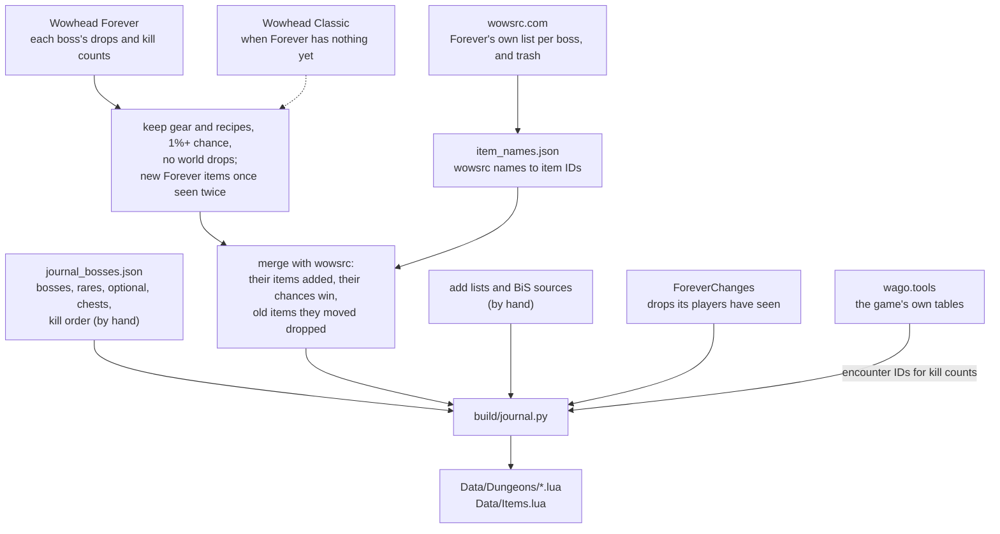

# Dungeon Journal

Every dungeon's bosses in kill order (rares, optional bosses and loot chests too, and a Trash
card), what each drops and how often, your BiS marked, your quests there, and a tip from
Naowh for each boss. Each classic dungeon has a map: the game's own art with every boss where
it stands, in a window of its own or filling the world map inside the dungeon. Its Reputation
tab has each faction's rewards by standing, with their prices; its PvP tab your rank this
season, what each rank gives, what the Marks of Honor buy, and the battleground factions:
Warsong Gulch's, Arathi Basin's, Alterac Valley's (with its insignia and Hero quests) and the
Darkspear Islands'. Its Crafting page lists every
profession's recipes (gear, consumables, enchants), each with its skill and source. Its Run Panel shows the run you are
in (time, gold, XP, trash and each boss against your best run), and its Runs tab every run you
have done. Off by default: players turn it
on in the Dungeon Journal settings page. It works without the BiS List: your BiS is marked only
while that is on, and the Journal offers to turn it on where it would show.

This module is the addon's reference for how a module is laid out and written (see
[`.github/STYLE.md`](../.github/STYLE.md)). Its folder holds everything that is only its own,
and it loads through its own `DungeonJournal.xml`. What any module can use (the house style,
components, windows, the row engine) is in [`Shared/`](../Shared/README.md); the BiS List is
built the same way.

## Layout

```
NaowhForever_DungeonJournal/
  NaowhForever_DungeonJournal.toc   its metadata, and one file line: DungeonJournal.xml
  DungeonJournal.xml   every file, in load order
  DungeonJournal.lua   settings (switch defaults from ns.FEATURES.journal), the dungeon and faction registry, the public API (ns.Journal, J)
  Constants.lua        the numbers several files share: a quest record's fields, the map art's size and path (J.C)
  Loot.lua             the loot rules: what is listed, BiS ranks, upgrades, looks (J.Loot)
  Finder.lua           the Loot Finder's rules: its picks, which loot fits them, in what order (J.Finder)
  Crafting.lua         the Crafting page's rules: each profession's recipes from the Professions module, its picks, what fits them (J.Crafting)
  Quests.lua           the quest rules: where each quest stands, its chain, its waypoint (J.Quests)
  Reputation.lua       your standing, rewards reached, prices, your PvP rank (J.Reputation)
  Team.lua             who was in your group and how they rolled, as short lines of text (J.Team)
  Kills.lua            this character's kills of each boss: when, how long, with whom, this run (J.Kills)
  Looted.lua           what this character has looted in the Journal's dungeons, with whom, the rolls (J.Looted)
  Runs.lua             this character's runs: time, splits, gold, XP, trash, deaths, loot and Need rolls, and the bests they set (J.Runs)
  Favourites.lua       this character's favourite items, where each drops, and the line naming them in a dungeon (J.Favourites)
  Sharing.lua          asking a group member with Naowh Forever to share a quest, and answering (J.Sharing)
  ShareQuests.lua      Share All: a dungeon's quests in your log shared, one at a time, with the members who need them
  AcceptShared.lua     Accept Shared Dungeon Quests
  Quartermasters.lua   where each faction's quartermaster and your rank vendor stand, and what the rank vendors sell at each rank, learned at the vendor
  ItemProbe.lua        /nf itemprobe: asks the server for every item listed, for Tools/sources/items_in_game.py
  Data/                data, no logic
    Build.lua          the game build the data is read from and its date, generated
    Names/<code>.lua   one per language but English: its bosses, chests, factions, places and Scarlet Monastery's subzones, generated
    Items.lua          the loot not in Forever yet, generated (the rest is Shared's ItemFacts)
    ItemStats.lua      each item's slot and stats, for the Loot Finder, generated
    Quests.lua         every dungeon quest, from Wowhead's Forever guide, with hand additions
    QuestChains.lua    each quest's chain, prerequisites, required level and reputation, and the steps done inside an instance, generated
    BiSQuests.lua      the quests that reward a BiS, for the BiS List's Quests page, generated
    RankRequirements.lua the line a rank vendor shows on an item you need a rank for, in each language, generated
    Dungeons/*.lua     one per dungeon, generated
    Maps.lua           each dungeon's map art, where its bosses stand, and the quest givers and objects inside it, by hand
    Factions/*.lua     one per faction with rewards, generated
    Tips.lua           Naowh's tips, by hand
    Abilities.lua      each boss's abilities as spell IDs, generated
    BossInfo.lua       each boss's level, kind and title, generated
    BossQuests.lua     the dungeon quests that need each boss, generated
    Keys.lua           the keys each dungeon needs or opens doors and shortcuts with, and what calls a boss, by hand
    Art.lua            each dungeon's loading screen from the game's files, for Dungeon Art, by hand
    Paintings.lua      each classic dungeon's painting and each boss's face from the game's files, for New Layout, generated
    QuestHelp.lua      which quests close another for good, and the items each quest asks for, generated
    QuestTips.lua      what to know before a dungeon quest or a step of its chain, by quest ID, by hand
    QuestRewards.lua   the items each quest rewards, to choose from and to get, generated
  View/                drawing a page on the shared row engine; used by the window, the map panel and the popups
    Style.lua          what only the Journal draws: colors, icons, sizes (J.Style, over Shared/Style.lua)
    View.lua           the view: per-draw answers, its events and redraws (J.View)
    Parts.lua          a fight's length, a boss's level and portrait, a row's band to its card's edges, side panels
    DungeonPage.lua    a dungeon's page: header, quests (handed in of all of them), each wing's boss cards, trash, the folded bosses
    BossPage.lua       a boss's own page: stacked (Boss Loot at Cursor) or compact (the dungeon map)
    FactionPage.lua    a faction's page and the PvP rank's, with the Marks of Honor
    SearchPage.lua     a search over every boss, item and faction reward
    FinderPage.lua     the Loot Finder: its picks, then the loot that fits, each with its boss and dungeon
    CraftingPage.lua   the Crafting page: its picks, then the recipes that fit, each with its slot, skill and source
    DungeonHeader.lua  the dungeon's name, entrance link, Find Group, the previous and next dungeon, zone and stats (quests to do, BiS, looks), with Dungeon Art on its loading screen behind them
    QuestMenu.lua      a quest's right-click menu and its chain menu
    QuestRows.lua      your quests: marks, hover card, the row
    BossTips.lua       Naowh's tips: tooltip lines, sharing one in chat, the tip row
    KillCount.lua      the skull and a boss's kill count, its tooltip and the history it opens
    BossCards.lua      a boss card's header, with its level, this run's kill or next boss inside, a rare's silver tag and ring, and, with Boss Portraits on, its face
    BossChips.lua      the bosses with nothing for you, as chips
    FinderPicks.lua    one group of the Loot Finder's or the Crafting page's picks, as chips
    ItemRows.lua       one item of a boss's loot, or a faction's reward with its price
    BossHeader.lua     a boss page's top: portrait, name, kill count, level and kind
    BossQuestRows.lua  the quests that need a boss, as rows or chips
    AbilityRows.lua    one of a boss's abilities, or an enchant on the Crafting page
    FactionHeader.lua  a faction's or the rank's header: where, quartermaster pin, stats
    StandingTrack.lua  your standing as a track, a segment per standing
    RankTrack.lua      your PvP rank as a track, a segment per rank
    TierHeader.lua     a card's header for one standing's or rank's rewards
    RewardGroup.lua    a kind of reward in a standing's card (gear, recipes, the rest)
    FactionLinks.lua   links between a faction and its dungeons
    FactionCard.lua    a faction as a card: standing meter, rewards unlocked, BiS left (New Layout)
    KeyLinks.lua       a dungeon's keys under its header, or what calls a boss on its card, marked when you carry one; with Quest Help, a key's quest chain
    IconLine.lua       a line under a faction's standing (what unlocked rewards would cost)
    RankReward.lua     a rank reward that is not an item
    ItemMenu.lua       an item's right-click menu (the BiS list, Favourites)
    QuestDetailRows.lua the quest panel's title, reputation needed, objective and item rows
    QuestPanel.lua     a quest in your log, in the side panel
    HistoryRows.lua    a boss history's kill header and its GROUP and LOOT labels
    TeamRow.lua        your group as it stood for a kill
    RollRows.lua       everyone's roll for an item
    BossPanel.lua      a boss's history: each kill, who was with you, what you looted and the rolls
  UI/                  where it shows
    ListParts.lua      what the window's two lists share: scroll, row bands, group titles
    DungeonList.lua    the window's list of dungeons, grouped by your level, each with your quests there done of total
    Home.lua           New Layout's first page: every dungeon as a card on its painting, grouped by your level
    FactionList.lua    the window's list on the Reputation and PvP tabs
    FactionHome.lua    New Layout's Reputation page: every faction as a card under its group
    Recent.lua         Recent on the window's title bar, not in New Layout: this character's latest kills and loot
    FavouritesPanel.lua Favourites on the window's title bar, not in New Layout: each favourite, where it drops, a tick once you have it
    FiltersMenu.lua    the title bar's Filters icon and its menu
    FactionSwitch.lua  the Alliance and Horde switch beside the search
    RunsPage.lua       the Runs tab: your runs by dungeon, and the picked run's times, splits, loot and the rest
    Window.lua         the Journal's window (/nfjournal, /nfdj, its own key binding) and its tabs
    MapPanel.lua       the Journal beside the world map; folds the game's quest log in a dungeon
    EntrancePins.xml   loads EntrancePins.lua, then the pin's template
    EntrancePins.lua   the dungeon and raid entrances as pins on the world map
    Popup.lua          Boss Loot at Cursor (a key binding)
    RareAlert.lua      Rare Alert: a toast and a chime when a rare of your dungeon is up, and a button that targets it
    RunPanel.lua       Run Panel: the run you are in, full or compact, and its summary when it is finished
    QuestTracker.lua   a dungeon's quests in a small window, one row each
    GameTrackerFade.lua Hide the Game's Quest Tracker
    TrackerAuto.lua    Open Tracker in Dungeons (Skip at Max Level) and Show Outside Dungeons
    MapView.lua        a dungeon's map drawn into a frame: art, boss and quest pins, entrance, stairs, floor switch (J.DungeonMap)
    MapList.lua        the bosses beside the map window, in kill order
    MapWindow.lua      the map's own window: the map, the list, the picked boss's page
    DungeonPane.lua    New Layout's dungeon page: header, then map, quests or keys and the picked boss beside every boss's loot
    MapOverlay.lua     the dungeon's map over the world map's picture, inside the dungeon
    MapTools.lua       /nf mappins (place the boss and quest pins, Copy for Data/Maps.lua) and /nf mapcheck
    ItemSource.lua     Where It Drops: the bosses that drop an item, with their dungeon and chance, on its tooltip anywhere
    SettingsPage.lua   its settings pages (Journal, Quest Tracker, Map), declared as cards
  Media/Maps/          local dungeon pictures as BLP, including 34 imported, 22 assembled and 21 of Santiago Reyes's downloads; selected by Data/Maps.lua
  README.md            this file
```

Each layer only uses the ones above it: `Data` fills `DungeonJournal.lua`'s registry, the
rules read both, `View` draws what they decide, and `UI` places a view on screen. Everything
the module shares hangs off `ns.Journal` (`J`); only the entry points the rest of the addon
calls are on `ns`.

## I want to change...

| What | Where |
| --- | --- |
| A colour, a size, spacing, an icon | `View/Style.lua`; the house look every module shares (borders, BiS stars, cards, item rows, windows) is `Shared/Style.lua`. A number one file uses is at the top of that file; the dungeon map's are at the top of `UI/MapView.lua` and `UI/MapWindow.lua` |
| A boss tip | `Data/Tips.lua`, keyed by the boss's NPC ID, one short sentence |
| A quest tip (done outside, finish before the last boss, a group quest) | `Data/QuestTips.lua`, keyed by the quest's ID, one short sentence; a step's tip shows on its quest while it is the step you are on, with Quest Help on |
| A dungeon's painting or a boss's face (New Layout) | `python Tools/build/journal_art.py`; a file it prints as not held is checked in a Forever client, then added to `Tools/data/journal_art_held.json` |
| New Layout's pages | `UI/Window.lua` switches them (`ApplyMode`, `ShowHome`); the dungeon page is `UI/DungeonPane.lua`, the home pages `UI/Home.lua` and `UI/FactionHome.lua`, and a view draws its new look from its flags (`lootDense`, `headAside`, `finderAside`, `factionAside`, `searchTable`) |
| The picture behind a dungeon's header (Dungeon Art) | `Data/Art.lua`: the file ID of the dungeon's loading screen, from the game's own tables (see Why) |
| A dungeon's bosses, wings, kill order, entrance or zone | `Tools/data/journal_bosses.json`, then `python Tools/build/journal.py` |
| Rare Alert's chime and how long its toast stays | `UI/RareAlert.lua` (`FIRST_GAP`, `GAP_GROWTH`, `CHIMES`, `TOAST_SECONDS`) |
| What a run counts, when it is finished, bests and averages | `Runs.lua`; the Run Panel is `UI/RunPanel.lua`, the Runs tab `UI/RunsPage.lua` |
| A rare, an optional boss or a loot chest | `"rare"`, `"optional"` or `"chests": { "Name": objectID }` on its wing in `Tools/data/journal_bosses.json` |
| An item a boss drops that no source has placed yet | `"add": { "Boss Name": [itemID] }` on the dungeon (`"Trash"` for its trash) |
| The chance of an item placed by hand, where Wowhead has no count for it | `"counts": { "Boss Name": { "itemID": [drops, kills] } }` on the dungeon, from loot players counted in game |
| A boss wowsrc names differently | `"wowsrcNames": { "Their Name": "Our Name" }` on the dungeon |
| A boss ForeverChanges names differently | `"foreverchangesNames": { "Their Name": "Our Name" }` on the dungeon |
| A boss's NPC ID the build cannot find | `"npcs": { "Name": ID }` on the dungeon in `Tools/data/journal_bosses.json` |
| Whether a dungeon is open, where the game's tables say otherwise | `"open": true` or `false` on the dungeon in `Tools/data/journal_bosses.json` |
| A quest giver, hand-in or quest object inside a dungeon | `quests` in `Data/Maps.lua` (see Data formats), then place it like a boss |
| Where a boss or quest pin stands on its dungeon's map | `/nf mappins` in game, drag the pins (one on another floor waits along the top, a right-click takes one off its floor), Copy, and paste the line into `Data/Maps.lua`. `/nf mapcheck` says which map art and floors the client has |
| A dungeon's map | `Data/Maps.lua`: its art folder (`Interface\WorldMap\<art>`) and floor count, as `/nf mapcheck` finds them, the order you walk its floors in, and the addon's own picture of a floor the art lacks (`Media/Maps`, a TGA or PNG turned into BLP by `Tools/media/compress_maps.py`); with none, Map says "Coming soon" |
| A key binding | `Bindings.xml` and its `BINDING_NAME_...` line (Open Dungeon Journal is in `UI/Window.lua`, Boss Loot at Cursor in `UI/Popup.lua`) |
| An icon's drawing | its function in `Tools/media/make_media.py`, then run it (writes `Core/Media/*.tga`) |
| What counts as usable, BiS, an upgrade, a new look | `Loot.lua` |
| Favourites: where each is found, the line in a dungeon | `Favourites.lua`; its mark is `FAVOURITE` in `View/Style.lua`, drawn by `star_outline` in `Tools/media/make_media.py`; its list is `UI/FavouritesPanel.lua` |
| The Loot Finder's picks, what each matches, its order | `Finder.lua`; an item's slot and stats are the game's ItemSparse, written by `python Tools/build/journal.py` |
| A quest's state, the list's order, where its waypoint goes | `Quests.lua` |
| Which Group Finder search Find Group opens | `ActivityOf` in `View/DungeonHeader.lua`; activities are matched to dungeons in `NaowhForever_Utilities/GroupFinder/Listings.lua` |
| A dungeon quest | `Data/Quests.lua`, then `python Tools/build/quest_chains.py` for its chain, `python Tools/build/quest_help.py` for what closes it and the items it asks for, and `python Tools/build/quest_rewards.py` for its rewards |
| What calls a boss (Quest Help) | `J.Summons` in `Data/Keys.lua`, keyed by the boss's NPC ID |
| A faction, its zone or the dungeons it is earned in | `Tools/data/journal_factions.json`, then `python Tools/build/factions.py` |
| What a standing means, prices in short, the PvP rank | `Reputation.lua` |
| The game build the faction data is read from | `BUILD` in `Tools/sources/wago.py`; the daily build watcher (`.github/workflows/daily-watch.yml`) opens a pull request when a newer one is out (or, where the organization does not let workflows open one, an issue with a one-click link to it). Items a new build lacks because wago.tools has not recorded its hotfixes yet are carried over from the build before (`CARRY_FROM`), and the pull request lists them |
| A setting or its default | `DungeonJournal.lua` (`UI.ModuleSettings("journal", ...)`; an on/off switch's default is in `Core/Features.lua`, `ns.FEATURES.journal`) and its card in `UI/SettingsPage.lua` |
| The line a rank vendor shows for each rank, after a new build | `python Tools/build/rank_requirements.py` |
| A boss's, chest's, faction's or place's name in other languages, after a new one | `python Tools/build/game_names.py`, after `journal.py`, `factions.py` or the BiS List's data |

`Data/Dungeons/*.lua`, `Data/Factions/*.lua`, `Data/Names/*.lua`, `Data/Items.lua`, `Data/ItemStats.lua`, Shared's `Data/ItemFacts.lua` and
`Data/FactionItems.lua`, `Data/Build.lua`, `Data/QuestChains.lua`, `Data/BiSQuests.lua`, `Data/RankRequirements.lua`,
`Data/Abilities.lua`, `Data/BossInfo.lua`, `Data/BossQuests.lua` and `Data/QuestRewards.lua` are generated: change their
source and rebuild rather than editing them, or the next build undoes the edit. Their builders
write the one-line header and nothing else as comments.

## Where the loot comes from

Nothing in the game client says who drops what (loot lives on the server), so the boss loot
is put together offline by `Tools/build/journal.py` and shipped as data. No source is right
on its own, so the build stacks them:



The rules, in plain words:

- **Wowhead** gives the drops and how often. It counts Classic Era's kills and Forever's
  together, so a new Forever item looks rarer than it is: it's kept once it has dropped
  twice, and shows no chance. A boss that's new in Forever has only Forever's kills, so its
  chances are real. Under 10 kills, no chance is shown, and a full build reads its page
  again. A new item Wowhead finds on three or more bosses is a random drop, not any one boss's,
  and is left out unless wowsrc or a hand list places it; placed, it comes after the boss's own.
- **wowsrc.com** lists what each boss drops in Forever (they gave us permission to use
  their site). It wins where it disagrees: its items go in, its chance is used, and an old
  item it lists somewhere else is taken off the boss. It's also where each Trash card comes
  from. Its pages have no item IDs, so `Tools/sources/wowsrc.py` maps names to IDs once and keeps
  them in `Tools/data/item_names.json`.
- **By hand** (`"add"`): items two other sources agree on that neither Wowhead nor wowsrc
  places yet, and an old item the wowsrc merge took off a boss where Wowhead's counts still give
  it a real chance, which it keeps (Herod's Scarlet Leggings, 1,801 of 12,682 kills). The trash
  cards of City of Dalaran, Excavation Site: Wetlands and Ruins of Lordaeron are by hand too, from
  ForeverChanges' and Wowhead's item sources: wowsrc has no trash for them. So are the drops
  ForeverChanges' dungeon pages mark seen in game that neither places (read 6 Nov 2026): the six
  leather helms and the Brawler's Leather Legguards and Defender's Leather Kilt patterns, on each
  boss of Blackfathom Deeps, the Stockade, Razorfen Kraul, Scarlet Monastery and Gnomeregan the
  pages list them on (Wowhead finds most of the helms there too, a few drops in thousands of
  kills); Obsidian Sentinel's new wand, breastplate and two axes and Plans: Warder's Boots; the
  Deadmines trash's Defias Rapier; Blueprint: Arcane Salvager on Charlga Razorflank and Rath'mael.
  The new dungeons' drops, rares and trash that none of those places (Shaper's Terrace's bosses,
  the Forever items of Zul'Farrak, Uldaman, Razorfen Downs and Stratholme's Malor the Zealous,
  and more of Blackmaw Hold's, Alcaz Prison's, Krol'dok Stronghold's and the Drowned City's) are
  from the same shared data set (read 14 Nov 2026), itself from Wowhead Forever's counts and
  players' screenshots; its recipes found on many bosses are left out, as Wowhead's are. Shaper's
  Terrace's Ravasaur Hunters fight is taken to be Izha'Rel and Tor'Rel, the two raptors fought
  together: the game names no fight after them. Its later update (read 16 Nov 2026) adds the
  late dungeons' own recipes (the flasks on Ras Frostwhisper, Balnazzar, Gyth and General
  Drakkisath, and the recipes the trash of Blackrock Depths, Blackrock Spire, Scholomance and
  Stratholme drops), Scholomance's and Stratholme's missing Tier 0 trash drops, and Blackmaw
  Hold's and Shaper's Terrace's trash it has seen drop; the items it only expects there are left
  out, and so are the recipes from plans and caches you open rather than kill. Its update read
  18 Nov 2026 adds Stratholme's Ezra Grimm, the optional boss of the smoke shop, with his
  blueprint (his gear is on Wowhead; no map pin yet, like Malor's); the blueprints Wowhead has
  seen drop on Nanaya, Vectus, Doctor Theolen Krastinov, Baroness Anastari and The Beast;
  Pimgib's Collar on Lethtendris; the Dungeon Set 1 pieces it confirmed on Blackrock Spire's
  trash and Quartermaster Zigris; and the trash drops of The Drowned City, Krol'dok Stronghold
  and Alcaz Prison. Jarien and Sothos are left out (their loot is in the chest they leave), and
  so are the reagents, ammunition and the drops it marks as only expected or extremely rare.
  Dalaran's two blueprints take their chance from `"counts"`, the drops players counted there
  (Spinning Wheel 14 of 166 Unstable Sentinel kills, Arcane Salvager 13 of 174 of the Shade's):
  Wowhead's answers for those bosses predate the recipes, so it counts neither. Its updates read
  25 Nov 2026 add Blackmaw Hold's rares Sabella No-Eyes and Mopes and Shaper's Terrace's King Op,
  whose drops Wowhead Forever has (King Op's two drop from Snowtalon and Vitrix too, so they are
  placed by hand, as is Vitrix's Albinofur Grips), Blackmaw Hold's two trash drops it only expected
  before, Shaper's Terrace's Pattern: Blue Dragonscale Helm on its trash, and the Avatar of
  Hakkar's Pattern: Mender's Leather Gauntlets.
- **ForeverChanges** (with their permission) marks the drops its players have seen in game on
  its dungeon pages. `Tools/build/foreverchanges_loot.py` reads them into
  `Tools/data/foreverchanges_loot.json`, and the build places them as an `"add"` list does: on
  the boss, after the hand list's, with no chance of their own; nothing is taken off and no
  chance changes. On a classic dungeon only the items new in Forever count: who drops what there
  is Classic's on their pages, and a mark on a Classic item only says its Forever version has
  been seen. A boss of theirs that is not one of ours (an object, a chest of ours, a mob we do
  not list) and a wing's trash but the last wing's are listed at the end of the build, not
  placed. Every drop the hand lists above took from their pages is on them too, but the Defias
  Rapier, a Classic item.
- **Everything, and what is not in Forever yet marked.** Forever keeps a row in its Item table
  for every Classic item, but the server only sends the items in the game; asked for any other,
  the client shows "Item 10800" and its tooltip waits forever. An item is in the game when its
  tables have it (ItemSparse, read through wago.tools, hotfixes in) or the server sent it
  (`Tools/data/items_in_game.json`, see below). The rest are still listed, as `NotYet` in
  `Data/Items.lua`: name, quality, levels and icon from Classic Era's tables, drawn without
  asking the server, tagged "Not in Forever yet", with a tooltip of our own. They are never
  your BiS, an upgrade or a look to collect, and nothing outside the Journal (the Gear Score,
  the BiS List's sources and picker) sees them. A build that has them makes them ordinary.
- **What the game sends.** wago.tools records the items Blizzard adds by hotfix late, and not
  always all of them (Ravager loads in game with no row there). `python Tools/sources/items_in_game.py`
  reads what a Forever client was sent, from its hotfix cache (`Cache/ADB/enUS/DBCache.bin`)
  and from `/nf itemprobe`, which asks the server for every item the Journal lists and keeps
  the answers for it at `/reload`. It writes `Tools/data/items_in_game.json`; commit it, then rebuild.
- **Open or not.** A dungeon is open when the game's own tables have at least half of its
  instance's boss loot (Scarlet Monastery's four wings are one instance), or `"open"` on it in
  `Tools/data/journal_bosses.json` says so; an item the server sends on request does not count. One
  not open says "Not open on Forever yet." at the top of its page (`closed` in its data). The
  Drowned City was opened by hand before any source had its bosses' loot.
- A boss nobody has loot for yet says so on its card. Keys and quest items are left out: the
  Journal lists gear (uncommon or better) and the recipes a boss drops (common or better).

To refresh it all: `python Tools/sources/wowsrc.py` (new pages), `python Tools/sources/wowsrc.py --resolve`
(new names), `python Tools/sources/recipe_drops.py` (the recipes each boss drops, by their item XML),
`python Tools/build/foreverchanges_loot.py` (the drops ForeverChanges' players have seen), then
`python Tools/build/journal.py`. Read what the build prints at the end:
bosses it found no loot for, wowsrc bosses we don't list, names it couldn't map, seen drops it
could not place.

The daily CI does the same when wowsrc's pages or ForeverChanges' seen drops change
(`.github/workflows/daily-watch.yml`, its `loot` job), with `--offline`: Wowhead is never asked
there, a new item's facts come from the game's own tables, and what they can't settle is listed
in the pull request it opens.

## Adding things

- **A dungeon:** add it to `Tools/data/journal_bosses.json`, rebuild, and add the line the build
  prints to `DungeonJournal.xml`.
- **A faction:** add it to `Tools/data/journal_factions.json` (its ID and tab), run
  `python Tools/build/factions.py`, and add the line it prints to `DungeonJournal.xml`. Its
  rewards, their standings and prices come from the game's own item tables, through
  wago.tools (`Tools/sources/wago.py`, whose `BUILD` is the game build they are read from). Its
  `zone`, any zones in its `"alsoIn"` list and its `battleground` become the game's map and
  instance IDs, from the game's map tables: there, the world map shows its page beside it
  (Factions Beside the Map). A zone name the tables do not know stops the build.
- **A faction reward the game's tables do not have yet** (announced, on the test realm):
  add it to the faction's `"add"` list in `Tools/data/journal_factions.json`, then run
  `python Tools/build/factions.py`. Standing by name, price in coins, both as the game
  writes them; `price` and `note` can be left out:

  ```json
  "add": [
      { "item": 272063, "standing": "Honored", "price": "9g 1s 14c", "note": "on the PTR" }
  ],
  "remove": [ 4996 ]
  ```

  `"remove"` drops a reward the tables have wrong. Once the game's tables list an added item
  as the faction's reward, theirs win and the build (and the build watcher's pull request)
  says its line can go.
- **A faction's repeatable hand-in:** the game's tables have no quest rewards (the server
  sends them), so these are kept by hand in the faction's `"turnins"` list in
  `Tools/data/journal_factions.json`, from the quest's page on Wowhead Forever: its name, its IDs
  (one per side), the reputation one hand-in gives and the items it takes. Then run
  `python Tools/build/factions.py`; an item the game's tables do not know stops it, as a typo.
  The faction's page lists them under Quests, with how many your bags hold:

  ```json
  "turnins": [
      { "name": "Minion's Scourgestones", "quests": [5402, 5408, 5510], "rep": 25, "takes": [[12840, 20]] }
  ]
  ```
- **A battleground faction's rewards:** the game's tables tie its quartermaster's items to no
  faction (both sides' quartermasters sell most of them), so they are listed by hand in its
  `"sells"`, by the standing each needs, from the quartermaster's Wowhead Forever page; their
  facts and prices are the tables'. Its quest chains are its `"quests"`, one quest a line, each
  step after the one it names, with the standing it needs, the reputation it gives, the items
  it rewards and who gives it; its page lists each step as a quest row, with its chain:

  ```json
  "sells": { "Friendly": [21565, 21566], "Honored": [19514] },
  "quests": [
      {"quest": 7162, "name": "Proving Grounds", "rep": 100, "get": [17691], "at": ["Lieutenant Haggerdin", "Alterac Mountains", 39.5, 81.2]},
      {"quest": 7168, "name": "Rise and Be Recognized", "after": 7162, "standing": "Friendly", "rep": 100, "get": [17900], "at": ["Lieutenant Haggerdin", "Alterac Mountains", 39.5, 81.2]}
  ]
  ```
- **A row kind:** a file in `View/` that fills `J.View.Kinds.<name>` with `New(view)`
  (makes the frame once) and `Set(row, ...)` (fills it and returns its height). List it in
  `DungeonJournal.xml` after `View/View.lua`, and draw it with `view:Add("<name>", ...)`.
  A kind every module could use goes in `Shared/View/Kinds.lua` instead.
- **A file:** list it in `DungeonJournal.xml` where its layer is, never in the TOC.

## Data formats

- `Data/Quests.lua`, one entry per dungeon, matched to its Journal dungeon by name:
  `{ name, map, levels = { min, max }, quests = { ... } }`. `map` is the instance ID from the
  game's Map table (build 1.60.1.69913; Blackmaw Hold's, The Drowned City's and Krol'dok
  Stronghold's 1.60.1.70862); it is nil where the
  client's Map table does not have the instance yet (still encrypted in 1.60.1), and those are
  found by the instance name `GetInstanceInfo` reports, so the name must be the client's own.
- Each quest record is `{ questID, name, level, side ("A", "H" or "B"), shareable (true, false, or
  "pre" for a prerequisite chain), where it starts, uiMapID, x, y }` (`J.C.QUEST` names the
  fields), the last three only when its quest giver stands outside the dungeon, `class` for a
  class quest (a list for one several classes take: Nostro's Compendium's warriors and paladins), and `races` for a quest only some races can take (a mask of their
  `PlayableRaceBit`s, from the quest entity export; Compendium of the Fallen's also lets Horde
  Skyborne in, whom the export's classic mask predates). Optional, from Wowhead's Forever quest
  database (2026-09-26), for the dungeons up to level 20 so far: `alt` (the same quest's other
  versions, one per faction, either of which counts), `steps` (the rest of its chain, all of which
  must be done for Done), `lead` (a lead-in that only counts while you carry it) and `next`
  (`next[i] = { uiMapID, x, y, where }`, where `steps[i]` is picked up). A step is a quest ID or a
  table of IDs (one per faction), any of which counts. `sides = { A = { where, uiMapID, x, y },
  H = { ... } }` is for a quest both factions take from different givers: once the player's
  faction is known (at load, or at PLAYER_LOGIN), its own giver replaces the text naming both
  and gets the waypoint. Only Tome of Twilight has one so far.
- The guide is Wowhead's Forever dungeon quest guide (patch 1.60.1, updated 2026-09-23).
  Positions on Stormwind, Mulgore, Redridge and the Eastern Plaguelands are converted to
  Forever's redrawn maps. The new dungeons' quests are by hand. Every dungeon's `levels` are
  the game's own: its Group Finder activity's `MinLevel` and `MaxLevelSuggestion` (GroupFinderActivity,
  build 1.60.1.70938, through wago.tools, read 2026-11-14), by the instance's map ID. Dire Maul's three
  wings are one dungeon here, so it takes the lowest and the highest (East 54, all 60). The Barrow Deeps
  and Hyjal Summit have no activity yet.
  City of Dalaran's quests are by hand too, from their Wowhead Forever pages (2026-10-05). The
  quests ForeverChanges' dungeon quest guide has that Wowhead's lacked (Destruction in Deadmines,
  the Excavation Site's breadcrumbs, the Horde paladin's A Moon-Kissed Blade) are by hand from its
  quest pages (2026-11-03); its Return of the Ring and second Sparklematic quest are `steps`.
  Past Due, new in Forever and on neither guide, is by hand from its ForeverChanges page
  (2026-11-04). The prerequisite chains live servers added to The Wrath of Rath'mael and The
  New Plague, and The Drowned City's two quests (no source has their givers yet), are by hand
  from Wowhead's Forever news, guide and quest pages (2026-11-06). The guide now links those
  chains where the quest starts, which `quest_chains.py` does not read, so they have no
  `QuestPrereqs` entry. The Drowned City's other quests are by hand from their ForeverChanges
  pages (2026-11-07), where only Ancient Gurubashi Idol has a giver, and Take Two With Water,
  which ForeverChanges does not have yet, from Warcraft Tavern's dungeon guide; its level 30 is
  the one every other quest there asks for. Locating the Lost City is the Horde's quest to find
  the entrance.
- Checked against the server's own quest data on 2026-11-07: EG Link's record of what players'
  games were sent (build 1.60.1.70840, CC BY 4.0, credited in `LICENSE.md`). The quests it files
  under The Drowned City, Krol'dok Stronghold, Alcaz Prison and Blackmaw Hold that no other source
  has are from there, as is Take Two With Water's giver, whom its quest text names. Shareable is
  the quest's own flag there. The dungeons from Blackrock Depths up were checked again on
  2026-11-10 (build 1.60.1.70862), which had three more of their quests' flags and the name
  Forever gives Finkle Einhorn's quest (Pip Quickwit, At Your Service!). Quest givers come from
  ForeverChanges' pins, except on the four redrawn maps (Stormwind, Mulgore, Redridge, the Eastern
  Plaguelands), where its spots are Classic's. An entry in `Tools/data/quest_info.json` with
  `from` has its required level from that source instead of Wowhead's page: the server's where the
  cached page is out of date, and ForeverChanges' (else the server's) for quests the cache has no
  page for.
- The quests ForeverChanges and the server file under a dungeon that the guide left out are in
  too (2026-11-07): a quest with its own start is a row (Dire Maul's class books, the Valthalak
  amulet pieces in the dungeon each spirit is summoned in, The Challenge under Blackrock Depths,
  where it is fought), and a step of a listed quest's chain is in that chain (Precarious
  Predicament, A Crumpled Up Note, the Sparklematic and Platinum Discs versions, the libram and
  Gordok repeatables). A chain in `Tools/data/quest_chains.json` with `from` says where it is from:
  the Quest List's (`NaowhForever_DiscoveryData/Quests.lua`, `D.Chains`), where Wowhead's cached
  Series had none or only part of it, or players' reports (Blackmaw Reclamation's from Ekkal on,
  the paladin storyline before Materials of Significance, the rogue jobs before Fool Me Twice). An item that starts a quest is the game's `ItemSparse.StartQuestID`. Quests
  no source gives a start for and the server has no data on (When Dreams Turn to Nightmares,
  Waking Naralex, the second Unfinished Gordok Business) are left out.
- The quests ForeverChanges has since filed under Blackmaw Hold, Shaper's Terrace and Blackrock
  Depths were added by hand from its quest list and pages (2026-11-10), with the server's data where EG
  Link has them (build 1.60.1.70862: Claws That Rend, Tusks that Gore and the Alliance's Get to
  the Roots of It). Their level is the required level, as on the other new dungeons' quests, and
  shareable is ForeverChanges' where the server's data has none. No source had their givers then,
  so they started at TBD with whom their quest text says to hand them in to. Shaper's Terrace's six
  have their givers from a dungeon data set its author shared with us (read 2026-11-14), at the spots
  the Quest List has for the same NPCs; Digestible Research starts from the Partially Digested
  Journal on the ground inside the dungeon, so it has no waypoint. Blood and Thunder,
  filed under Blackrock Spire, is left out: it only sends you to Warlord Goretooth, and neither
  source says which wing it is for.
- The quests ForeverChanges has since filed under Alcaz Prison, Krol'dok Stronghold, Razorfen
  Downs, Zul'Farrak and Maraudon were added by hand from its quest list (2026-11-13), each
  checked against EG Link's server data (build 1.60.1.70888), which gives the same levels and
  is where shareable and the chains (`steps`) are from. The Coldbringer's Eye's Alliance giver is
  ForeverChanges' pin, as is Twilight Mementos'; Commander Folkar and Mason Connery, inside the
  prison, are the givers their quest text names. Five more that only the server's data has are in
  too: Krol'dok No More! (the Alliance's; the Horde's version is unfinished there), Blackmaw
  Reclamation, A Lost Memento, Digestible Research and The Broken Glaive. Left out: the other
  versions of State Secrets and Blackmaw Pouches, which have no text, the City of Dalaran's
  level 52 to 60 quests, which are the city's and not the dungeon's, and the Season of Discovery
  quest the server also sent (Ever After). Nostro's Compendium is Forever's name for Foror's
  Compendium, the guide's row.
- The givers left at TBD (Blackmaw Hold's, Alcaz Prison's, two of Krol'dok Stronghold's, Zul'Farrak's,
  Maraudon's and Razorfen Downs' Agamaggan's Blood) are the Quest List's spots for them, from
  Forever's own data (2026-11-25), which the shared data set's later updates agree with; State
  Secrets starts from the Document Box that More Valuable Than Gold rewards. From those updates
  too, checked against Wowhead Forever's pages: Materials of Significance (Alliance paladins, in
  Maraudon's and Blackrock Depths' lists, where two of its parts are), The Talisman of Kazdor
  (rogues, Zul'Farrak), Dreadsteed of Xoroth (warlocks, Dire Maul, where Lord Hel'nurath is
  summoned) and the Alliance's The Darkreaver Menace; the Horde's is 8258 on Forever, not the
  classic 7668. The Medallion of Faith is repeatable on Forever (the Quest List's `D.Repeatable`).
- Scarlet Monastery's four wings share one instance (189), each its own dungeon with classic's
  ranges. A quest goes under the wing it is done in: Hearts of Zeal (hearts from any wing) under
  the first, the two that kill Loksey, Herod, Mograine and Whitemane under the Cathedral.
- `J.QuestTurnIns`: quest ID -> `{ uiMapID, x, y, who }`, where a quest is handed in when that
  is not its quest giver; a quest in your log is tracked to it. From Wowhead Forever's NPC
  pages (2026-09-26), with Classic-era spots dropped on the redrawn maps; The Glowing Shard
  follows the in-game quest text, which Wowhead has wrong. Dungeons up to level 20 so far.
- `Data/QuestChains.lua`: `QuestChains` (questID -> every step of its chain in order),
  `QuestPrereqs` (the steps before it can be picked up), `QuestMinLevel`, `QuestMinRep`
  (`{ faction ID, reputation, faction name }`, the reputation as the game counts it: Neutral 0,
  Friendly 3000), `QuestInside` (a step -> the area of the instance its objectives are in),
  `QuestWhere` (the where text without the guide's prerequisite note), `QuestChainNames` and `QuestChainStarts`
  (`{ uiMapID, x, y, quest giver }`) for the steps not in `Data/Quests.lua`. A step with no
  usable start on its quest page takes the Quest List's spot (`D.Quests`), which is converted on
  the redrawn maps and, for a quest an item begins, is where the mob that drops it spawns
  (Underground Map: Captain Beld). Build the Quest List first.
- A quest's reputation is the quest entity catalog's `requiredMinRep`; Forever's own quests are
  not in the catalog, so their `Tools/data/quest_info.json` entry takes a `minrep` by hand, from
  players' reports (Blackmaw Hold's Twin Bears, Blackmaw Reclamation and A Lost Memento: Neutral
  with Timbermaw Hold). Its faction must have a page in `Data/Factions`, where its name is from.
- A step is inside an instance when every objective spot its Wowhead Forever quest page has
  (`Tools/data/quest_objective_spots.json`) is in an instance's area
  (`Tools/data/instance_areas.json`). A step whose objectives are partly outside, or that page
  places none of, is not marked; nor is one only handed in or started inside.
- `Data/Maps.lua`: `[dungeon key] = { art, floors, names, order, image, images, imageBottom, floor, entrance,
  stairs, pins }`. `art` is the folder of `Interface\WorldMap\<art>\<art><floor>_<tile>`: twelve 256px
  tiles four across, of which the map shows the top left 1002 by 668. `order` lists the art's
  floors in the order you walk them where the art's own numbers are not that order, or it holds
  another dungeon's floors (the switch offers only these; pins keep the art's number). `image`
  is a local picture (`Media/Maps`). Without `images`, floors after the first append their
  number to `image`; `images = { [floor] = picture }` supplies explicit paths instead and can
  replace individual tiled floors. `imageBottom` is the bottom texture coordinate: `1`
  shows a complete image; the default `683 / 1024` crops older square TGAs to their map area.
  `floor` restricts a dungeon to one floor of shared art. Scarlet Monastery's wings now each
  use a separate one-floor picture. `entrance = { floor, x, y }`,
  `stairs = { { floor, x, y, to = floor, item = key's item ID } }` (an arrow that shows the floor it
  leads to, down when `to` is the higher number, naming the key if one opens it) and
  `pins = { [NPC ID] = { floor, x, y } }` (a chest by minus its object ID), x and y from 0 to
  1 across and down. Pins and floor numbers follow the chosen picture. `quests = { { npc or
  object = ID, name, start, finish, use } }` are the quest givers, hand-ins and quest objects that
  stand inside the dungeon: `start` the quests it gives, `finish` those it takes, `use` those it is
  clicked, burned or killed for, each a quest ID or `{ A = ID, H = ID }` (one side's only). Its spot is a
  `pins` entry under the same key as a boss's (an object's by minus its ID), placed with
  `/nf mappins`; one with no spot is not drawn. An NPC that is a Journal boss too (Baelog, Princess
  Moira, Stomper Kreeg, Captain Kromcrush) is left out: the key is its boss pin's.
  `also = { [NPC ID] = { { floor, x, y }, ... } }` are the other spots a boss can spawn at, drawn
  faded under its own pin and not placed with `/nf mappins` (Lorgus Jett's two up Blackfathom
  Deeps' northern channel). The Stockade's Targorr the Dread and Bruegal Ironknuckle each have
  four spawn points in CMaNGOS classic-db, turned into spots by the game's UiMapAssignment as
  below (the Stockade's picture is the game's map layout, and Kam Deepfury, Hamhock and Bazil
  Thredd land within 0.01 of their pins); a player's marked map puts Targorr in the same four
  cells. Each pin is one of the four, the other three are its `also`.
- The quest pins' list is from the Journal's quest data and chains, quest_entity_catalog.json's
  givers and hand-ins, and the where text and quest text that put them inside (2026-11-13). The
  Ghostly Attendant (Hall of Thanes), Rexxie Copperclutch (City of Dalaran) and Mason Connery
  (Alcaz Prison) are not listed: no source has their NPC IDs. Krol'dok Stronghold's Tunk (his
  Krol'dok Moulding starts the key quests) and Zalfan Moonshadow, and Nar'gurk's pin, are from a
  player's marked map in the shared data set (2026-11-20), on the same art.
- Most quest pins, and the rares and bosses that had no spot, were placed without the game (2026-11-13).
  The Journal's pictures of the classic dungeons keep the game's own map layout, so a spot on that
  layout needs no change. A floor's spots were taken from marks made on that layout only where the
  same marks put the floor's bosses within 0.03 of their pins here; where they had none, CMaNGOS
  classic-db's spawn point, turned into a floor and a spot by the game's UiMapAssignment (Classic
  Anniversary's, through wago.tools; Forever's has no dungeon rows), on a floor where that puts the
  placed bosses within 0.05 of their pins. Dire Maul West's floors overlap in height and the table
  puts its library a floor too low, so its spawn-only spots were left out. The Grim Guzzler's three
  quest NPCs and Ribbly Screwspigot are fitted to Blackrock Depths' placed bosses instead.
  Scholomance and Shadowfang Keep use other pictures, and Forever's own dungeons have no spawns:
  what is left there is placed in game.
- City of Dalaran uses two explicit pictures named Sewers and Streets in the floor switch.
- Upper Blackrock Spire keeps screenshots of Blizzard's later map (Wowhead screenshots
  852258 and 852257) for floors 8 and 9. Its order is Dragonspire Hall (9), Emberseer and
  Solakar (8), then Rend and Drakkisath (7); floor 7 is now a bundled picture in Media/Maps.
- `Data/Keys.lua`: dungeon key -> its keys in order, each `{ item, quest or boss, opens }`:
  `quest` is the quest that gives it (a quest ID, or `{ A = ID, H = ID }` per faction), `boss` the
  NPC ID of the Journal boss that drops it (or guards its chest), and `opens` is `"doors"` or
  `"shortcut"`, left out for a key needed to get in. Every item ID is in Forever's own ItemSparse
  (build 1.60.1.70938). The quests that give a key are ForeverChanges' (Dark Iron Legacy, The
  Key to Scholomance, Seal of Ascension, Drakefire Amulet, Blood of the Black Dragon Champion,
  The Scepter of Celebras); which boss drops a key is classic's. A key's quest is one the
  Journal lists: the Seal is given by 4743, the second step of 4742's chain, so the key names 4742.
  The Dalaran Sewer Key and Krol'dok's keys are not listed: no source says what gives them or
  what they open.
- `Data/ItemStats.lua`: item ID -> `{ inventory type, then its stat types }`, the game's own
  numbers (`Enum.InventoryType`; 3 agility, 7 stamina, 51 fire resistance), from Forever's ItemSparse
  (`StatModifier_bonusStat_0` to `_9`), else Classic Era's for an item not in Forever yet. Only which
  stats an item has, not how much: the table keeps each stat's share of the item's budget, not its
  value. A recipe (no slot) is left out.
- `J.Summons` (also `Data/Keys.lua`): boss NPC ID -> what you use to call it, as keys are, with
  `opens = "summon"`, and `drop` and `zone` (a uiMapID) for one a creature outside the Journal drops.
  Every item is in Forever's own ItemSparse (build 1.60.1.70938). The Mallet of Zul'Farrak for
  Gahz'rilla drops from Qiaga the Keeper in The Hinterlands, as Wowhead's Forever dungeon quest guide
  says on Gahz'rilla's quest. The quests that give the rest are `quest_entity_catalog.json`'s
  (`sourceItemId`), and their objectives there name the boss: The God Hakkar's Egg of Hakkar for the
  Avatar of Hakkar, Kirtonos the Herald's Blood of Innocents, the Brazier of Beckoning each Left Piece
  of Lord Valthalak's Amulet gives for Mor Grayhoof (Lower Blackrock Spire), Isalien (Dire Maul) and
  Kormok (Scholomance), and Mea Culpa, Lord Valthalak's for Lord Valthalak. Urok Doomhowl needs
  Omokk's Head (the catalog's `requiredSourceItems` for the Urok Doomhowl quest), which Highlord
  Omokk drops, as his tip says. Jarien and Sothos are not Journal bosses, and the Divination Scryer
  for Death Knight Darkreaver is for one class's quest only, so neither is listed.
- `Data/QuestHelp.lua`, by `Tools/build/quest_help.py`: `QuestClosedBy` (a quest -> the quests that
  close it for good once done or in your log), read from `quest_entity_catalog.json` as the Quest
  List reads them: its exclusiveTo, a breadcrumb's target (breadcrumbForQuestId, or the target's
  breadcrumbs), and disabledByQuest. That gives three breadcrumbs (In Search of Thaelrid before
  Blackfathom Villainy, The Lost Dwarves before The Hidden Chamber, The Day After before Gnogaine),
  Chief Engineer Scooty, which Rig Wars closes, the four versions of each piece of Lord Valthalak's
  Amulet (one per dungeon), and the shaman's two versions of The Darkreaver Menace.
  `QuestClosedByNames` names a closing quest the Journal does not list. `QuestItems` (a quest or a
  step of its chain -> `{ item, count, boss NPC ID }`) is the item objectives on its Wowhead Forever
  page, as `boss_quests.py` cached them (`quest_objectives_cache.json`); the boss is one of its
  dungeon whose name the game's own name for the item carries (ItemSparse, through wago.tools), else
  the one boss the objective names when it asks for one item and no kill. No other source says which
  boss drops a quest item: the Journal's loot leaves quest items out.
- `Data/BossInfo.lua`: NPC ID -> `{ lowest level, highest level (-1: ??; both nil where its
  page has no level), classification (0 normal, 1 elite, 2 rare elite, 3 boss, 4 rare), creature
  type (Wowhead's number: 7 is Humanoid), title or nil }`. A boss with no level shows none, on its
  card or its page: ?? is only the game's own skull level.
- `Data/Tips.lua`: one short sentence each about the classic fight, from warcraft.wiki.gg's
  classic pages, the Warcraft Tavern and Almar's classic guides, and Wowhead Forever for
  Forever's own dungeons. Bosses with no NPC ID yet have none.
- Kept per character (`journalKills`, `journalLoot`, `journalRun`): a kill record is `{ n,
  first, at, took, team, drops, best, bestAt }`, the lists running alongside `at` (false where
  not kept); a loot record `{ id, link, at, dungeon, boss, team, rolls }`. A team is one line,
  `"Emmy,PRIEST,H,;Die Man,ROGUE,D,m"` (name, class, role T/H/D/N, m on you); rolls are
  `"Ding,3,96,w,SHAMAN;Emmy,3,88,,DRUID"` (name, `Enum.EncounterLootDropRollState`, the roll, w
  on the winner, class). A kill's drops are one line per item: its link, a tab, its rolls.
- Kept per character too, `journalRuns`: up to `KEEP` (50) runs, oldest first, each `{ dungeon,
  start, last, ended, leftAt, done, wing, partial, kills, copper, xp, deaths, trash, out, needWon,
  needLost, rolled, loot, team, entered, copy }`. `kills` is encounter ID -> seconds from the door, `done` the
  seconds to the kill that finished it and `wing` that wing's index, `out` the seconds spent
  outside, `rolled` the drops (`"encounterID:lootListKey"`) whose Need roll was counted, and `loot`
  the loot records above, `entered` when you last came in and `copy` the instance copy. Kept for the account, `journalTrash`: dungeon key -> the most trash a
  finished run there killed; and `journalRunPanel`, the panel's position.
- Kept per character too, `journalFavourites`: item ID -> `true` for each favourite; taking one off
  removes its key.
- Quest sharing messages, prefix `NaowhJournal`, version first: `1 A <theirs> <yours> <quest
  IDs>` asks them for the first of these in their log; `1 R <yours> <theirs> <quest ID> <code>`
  answers with S shared, N not in their log, P the game does not let it be shared, W wait.

## Why

- New Layout is on by default (`newLayout` in `Core/Features.lua`); a player who turned it off
  keeps it off. Nothing it adds is built while it is off, and the window then draws the old lists.
- Map Size (`mapSize`) widens the dungeon page's map column and grows the window by that width and
  the map's extra height, so the loot columns and the boss under the map keep their room. The
  window is the same size on every New Layout page; the old lists ignore the setting.
  The window never grows past the screen (less a 32 px margin, at the Journal's Window Scale): a
  smaller screen gets a smaller map, and one the base window already fills keeps the map at 100%.
- New Layout's paintings and boss faces are the game's Encounter Journal art. Forever has no
  Encounter Journal tables but its client holds the files, so nothing is shipped: the file IDs
  come from retail's JournalInstance and JournalEncounterCreature tables, and only files a Forever
  client was checked to hold are written (`Tools/data/journal_art_held.json`). Forever's new
  dungeons have no painting and keep their loading screen or a plain card.
- A dungeon's key or attunement tag on New Layout's home page shows only for a key without `opens`
  in `Data/Keys.lua`: one needed to get in, not one for doors, shortcuts or a summon.
- New Layout's lockout line matches a saved instance by `GetSavedInstanceInfo`'s map ID against
  the dungeon's `instance`. Its reset counts down from the last `UPDATE_INSTANCE_INFO`, not from now.
- `Media/Maps` pictures are 1024 by 1024 DXT1 BLP files with mipmaps, about 700 KB each. As TGA
  they were 2 to 3 MB each and most of the addon's download.
- The map frame stretches its picture to the frame, so a 1000 by 667 or 1200 by 800 picture is
  stored at 1024 by 1024 and still drawn at its own shape, whole, with its credits.
- `ForeverInstanceMaps` pictures keep their art unchanged, only stored as BLP, and require no
  other addon at runtime.
- `Media/Maps` includes 34 pictures imported through the local
  ForeverInstanceMaps addon backup. No public repository URL for that addon is recorded.
- The Hall of Thanes, Ruins of Lordaeron, Excavation Site, City of Dalaran, The Drowned City,
  Krol'dok Stronghold, Shaper's Terrace, Alcaz Prison and Blackmaw Hold illustrations, and the
  Sunken Temple's floors 2 to 5, are by Santiago Reyes,
  [Atlas de Azeroth: Forever](https://sreyesmaps.com/post/proyecto-atlas-de-azeroth-forever).
  He gave us permission to use his maps in the addon. His conditions ask that watermarks and
  credits remain intact, so each picture is his whole map, scaled, never cropped or edited.
- City of Dalaran, The Drowned City and Krol'dok Stronghold are his sreyesmaps.com downloads
  of 2026-11-07, scaled from 3000 by 2000 to 1200 by 800: Dalaran's two floors and the Drowned
  City's main city are his 11/26 versions, Atal'Byzal and Krol'dok his pre-beta ones. The Hall
  of Thanes, Ruins of Lordaeron and Excavation Site (his version 2.0) already matched his
  current pictures.
- Alcaz Prison's Main Unit and Maximum Security Unit (his 11/26 version) are his sreyesmaps.com
  downloads of 2026-11-08, scaled the same way.
- Shaper's Terrace (his 11/26 version) and the Prismatic Talus are his sreyesmaps.com
  downloads of 2026-11-09, scaled the same way.
- Shaper's Terrace's portal stands north of the Un'Goro map's edge, so its entrance is the stairs up to it on
  Un'Goro's northern rim, above Marshal's Refuge, where the world map shows it in Un'Goro. Krol'dok
  Stronghold's, Alcaz Prison's and Blackmaw Hold's entrances are from an entrance guide (Nov 2026).
- Alcaz Prison and Blackmaw Hold have no pins yet: his maps mark no bosses and no source says
  where they stand. With no pins, every floor is offered.
- Shaper's Terrace's pins are Wowhead's Forever spawn spots, which it gives on the Kalimdor map
  (the instance shares Kalimdor's coordinates), drawn onto the instance's minimap tiles from the
  game files and carried onto his art through ten landmarks both show, since his art is not to
  scale. Every boss stands on the first level, so the Prismatic Talus is no longer offered.
  King Op has no pin: Wowhead Forever gives no spawn spots for him (nor any longer for the
  others), and no other source says where he stands (25 Nov 2026).
- Blackmaw Hold's six levels are his sreyesmaps.com downloads of 2026-11-13, scaled the same
  way. They replace the four pictures we had drawn from the game's files. The floor names are
  the ones on his art; his first level's label misspells Blackmaw Grove.
- The Sunken Temple's floors 2 to 5 (Entrance, Hall of the Cursed, The Pit of Refuse, Hall of
  Serpents) are his sreyesmaps.com downloads of 2026-11-13, the levels Blizzard's map leaves
  out. The Sunken Temple keeps the default square crop for its first floor, so each is his
  whole 2100 by 1400 map scaled to 1024 by 683 at the top of the square. Floor 1 and its pins
  are unchanged.
- Quest Pins (`mapQuestPins`) marks each quest pin as the quest rows do: the best of its quests
  for you first (one to hand in, one to pick up, one too high, one in your log, one under your
  level, one waiting on its chain), greyed and faded when none is for you now. A quest the list
  does not have (a chain's later step) waits on the step before it in a listed quest's chain. While
  a map with quest pins is drawn it listens for `QUEST_LOG_UPDATE`, `QUEST_DATA_LOAD_RESULT` and
  `PLAYER_LEVEL_UP`, redraws once on the next frame for a burst of them, only when the quests'
  signature (as the page's, with your level) has changed, and stops listening at the first one with
  no such map shown. `/nf mappins` offers every quest pin, on or off.
- Blackmaw Hold has no pins yet: nobody has placed its bosses with `/nf mappins`, so its map shows
  only beside the world map, inside the dungeon.
- The same folder contains 22 pictures assembled from map tiles in
  [keyboardturner/WoWMapUprez_Dungeons](https://github.com/keyboardturner/WoWMapUprez_Dungeons),
  commit `c8325d4583c9cdce52658e1a245963e623501dfa`. The project upscales Blizzard's
  original dungeon map artwork.
- Imported pictures use `imageBottom = 1` to show the entire image without the older square
  TGA crop.
- A spot saved by `/nf mappins` on a floor its map no longer has is ignored for the data's spot:
  placings made before the pictures changed used the old floor numbers.
- Boss positions imported with those pictures use one marker per NPC: grouped bosses share
  a position, and multi-spawn rares use their first spot. Some positions are estimates;
  Journal-only positions are retained where the source has no matching boss. Each boss pin
  sits on its skull where the picture has one. Captain Greenskin and Odo the Blindwatcher have
  none: Greenskin stands on the ship's deck ahead of Mr. Smite, Odo on the rampart past
  Commander Springvale. Razorfen Kraul's skulls are not numbered, so its bosses take them in
  kill order along the path from the entrance.
- Sunken Temple, Blackrock Depths, Dire Maul, Blackrock Spire, Scholomance and Stratholme
  use bundled TGA pictures from `Media/Maps`: their client texture paths and
  numeric file IDs can fail on the Russian client. These pictures preserve the tiled map's
  visible area, so the existing floor order and pin coordinates still apply. Upper Blackrock
  Spire keeps its existing pictures for floors 8 and 9. No other addon is required at runtime.

- The on/off switches' defaults (`enabled`, `mapPanel`, `mapFactions`, `mapEntrances`, `entranceJournal`, `rareAlert`, `mapQuestPins`, `lootFinder`, `crafting`) are read
  from `ns.FEATURES.journal`: one file holds every feature's switch and default.
- Under Forever's Gamepad interface style (`ns.GamepadStandDown()`) the panel beside the world map
  and Hide the Game's Quest Tracker stay off, and their settings say why. That style opens and
  navigates the world map and drives the game's tracker from secure code, which our hooks on the
  map and the tracker's faded alpha would taint. The entrance pins stay: they are a data provider
  through the map's own API. Opening the map from the Journal goes through `Places.ShowMap`.
- The opacity was one setting (`windowAlpha`) before the tracker had its own: a player who set it
  keeps it on the tracker, copied once on the first login with it; the tracker's own setting, once
  set, is never written over. The Journal's windows have no opacity setting: they are always solid.
- Where It Drops lists an item's three likeliest sources and counts the rest; the Journal's own item rows
  (`journalItem`) skip it, as they already say where the item drops. The tooltip hook cannot be removed,
  so it is added the first time the setting is on and checks the setting on every tooltip.
- `J.OPTION_GROUPS` is the one list the Filters menu and the settings page are built from, so
  both offer the same switches in the same words, and either changes the other.
- Dungeons sharing one instance (Scarlet Monastery's wings, Lower and Upper Blackrock Spire) are
  told apart by the map you stand on (`WING_MAPS`, Scarlet Monastery's 302 to 305), else by the
  subzone (`SUBZONES`), else by the one last told apart in that instance, forgotten when you
  leave; before any, the data's order, the first first. Many rooms have no subzone in
  WMOAreaTable, so the subzone alone put the Cathedral on the Graveyard. Blackrock Spire's halves
  share one map, so only subzones tell them apart: Hordemar City and Hall of Blackhand are left
  out, as the way into Upper runs through them. The subzone may only be known after the loading
  screen, so the quest tracker also listens for `ZONE_CHANGED` and `ZONE_CHANGED_INDOORS`.
- Factions here walk the map up to its zone: a cave's or a town's map counts as its zone's. In
  a battleground only your side's factions count.
- A creature's NPC ID comes from its GUID (`J.NpcID`), and a GUID the game keeps secret (enemies
  in combat, in some places) cannot be read: Boss Loot at Cursor checks `issecretvalue` first.
- The world map is opened from addon code only out of combat, where the game lets it; a
  right-click up to the zone on the dungeon's map shows the world instead in combat.
- What a character keeps is saved under its GUID (first names are not unique on Forever),
  account-wide and outside every profile, so a profile switch or an exported profile never
  carries it.
- A recipe's subclass maps to its profession's skill line as `GetProfessionInfo` names it
  (`RECIPE_SKILL`); a book (0) is no profession's and is listed whatever yours are. A cosmetic
  item is armor subclass 5.
- A recipe is kept from common quality, not uncommon like gear: many recipes bosses drop are
  white. Its facts say no armor type (`{ 4, 0 }`), as a faction's recipe rewards do, so every
  class can use it: its own subclass is its profession, and Alchemy's 6 would read as a shield.
- Asked for a recipe's look, the game answers with the look of the item it makes, so only
  items with a slot count as wearable. The game has no appearance for some wearable items
  (Prison Shank on Forever 1.60.1): then whether you have the item's own look is all it can say.
- An upgrade on your BiS list must be a higher pick than the list's piece you wear there; off
  it, an item you can wear now that your stat weights (the BiS List's Stat Weights, when that addon
  is loaded) make you stronger with, shown as its percent, else one with a higher item level,
  never over a piece of your list.
- The quest data's level is the guide's and often matches neither the quest log's nor the
  required level, so it is only the fallback until the client loads the quest (asked once;
  `QUEST_DATA_LOAD_RESULT` redraws).
- `TOO_HIGH` is 5: a quest five or more levels above you is marked too high.
- Quest Help (`questHelp`, on by default) warns in red on a quest's hover card while it can still
  be lost, and once a quest that closes it is done or in your log, lists it grey and last as no
  longer offered, counted in neither the dungeon's quests nor its progress. The game never says a
  quest is closed, so this is the catalog's rule, not the server's answer. A quest in your log is
  never closed by it, so the quest panel has no warning to show.
- A key's chain (Quest Help) is its quest's chain as the quest rows show it: a click opens the same
  chain menu, Shift-click still links the key. The step you are on is the one after the last handed in, as for prerequisites.
- Forever gives a quest link (`GetQuestLink`) only for a quest in your log, even after
  `C_QuestLog.RequestLoadQuestByID`, so Link in Chat and Shift-click work only for those.
- The quest panel's item counts are your bags' (`C_Item.GetItemCount`) against the page's count.
- The next prerequisite is the one after the last step done: a later step done means the ones
  before it are, even a lead-in the game never flags as completed. Wowhead's Series often starts
  partway, so a chain puts the prerequisites first; each path is worked out once.
- Forever's own quests (Excavation Site: Wetlands' Earthen Echo) have no Series on Wowhead, so
  `quest_chains.py` finds no chain for them. Their guide note says "Follow-up from <quest>"
  instead: on load the quest rules chain that quest after the one it names in the same dungeon
  (its own side's first) and make it wait on it, unless the generated data already has a chain.
- Forever has no route (`C_QuestLog.GetNextWaypoint`) for many vanilla quests: without one a
  waypoint falls back to the turn-in NPC, then the quest giver. A quest that starts inside its
  dungeon (from a drop) has its waypoint at the dungeon's entrance.
- Tracking a quest selects and super-tracks it without opening the log: the quest log lives on
  the world map in this engine, and opening it from addon code taints the map's quest pins (the
  next time the map opens in combat, their `SetPassThroughButtons` is blocked). The quest panel
  shows a quest beside the window for the same reason, and reads its text and rewards by
  selecting it in the log and putting your selection back straight after.
- The quest list's signature (`SIGNATURE_BASE` 10, one more than the nine kinds, modulo
  2147483647) is made without a table; two states giving the same number is rare and only
  delays a redraw to the next event.
- A grey quest is left off the list, but a faction's hand-in is not: its reputation is worth it
  at any level.
- Link in Chat never opens the chat box: `ChatFrameUtil.OpenChat` from addon code taints the
  edit box and the game then blocks the next message. It joins an open box, or goes to your
  group's chat, never to Say.
- `BAND` is each standing's size as the game counts it for every faction here (Neutral 3,000,
  Friendly 6,000, Honored 12,000, Revered 21,000): the game only says the one you are at, so a
  standing further away is "about".
- The PvP rank is the season's renown faction 2800, read as the game's own rank panel reads it;
  honor (1792) and rank points (3468) are the currencies its page shows.
- Forever's rank rewards are labels with no item behind them ("Rank 2 Rewards", "Insignia
  Trinket"): each unlocks items at the rank vendors, and the vendor, not the item, holds the rank
  an item needs. Its tooltip shows it in red, a PlayerCondition's text per rank ("Requires
  Corporal/Grunt (Rank 2)", seen on Forever 1.60.1, 2026-11-16), worded too differently between
  languages to read a number from, so the whole line is matched in the client's language. An
  item you have reached has no such line: it is only placed, at rank 1, while you are rank 1.
  A vendor lists your class's items only, so each character adds its own; they are kept per side,
  for the account.
- A price is shown rounded to its largest coin so the column stays narrow; the tooltip has it to
  the copper. Forever has the money string only as `C_CurrencyInfo.GetCoinTextureString`: the
  global `GetCoinTextureString` is not loaded.
- The game knows what a quest gives only once you have it, so a faction's page names the quests
  in your log; its repeatable hand-ins and Alterac Valley's quest chains are kept by hand. A
  chain's quests and rewards join the dungeon quests' chains (`J.QuestChains`) and rewards
  (`J.QuestRewards`) when the factions are first read, so its rows show their step, chain and
  rewards as a dungeon's do. A kept quest in your log is listed once, but still counts in the
  page's quests changing.
- A quartermaster's spot is learned only from an item one faction alone rewards: both sides'
  battleground quartermasters sell the same potions, rings and weapons, and the Alterac Valley
  ones the same tomes, so those place neither.
- The battleground quartermasters' rewards are the ones their Wowhead Forever pages show with a
  standing (read 25 Nov 2026). The level 25 items listed beside them with none (the Trainee's
  Sentinel Nightsaber and Outrider Wolf, the level 25 weapons) and the item level 78 legs are
  Season of Discovery's, and left out: players report the mount is not sold on Forever. The
  Warsong Gulch tabards show no standing there and are listed at Exalted, as in classic.
- The Marks of Honor and what each buys with Honor are Wowhead Forever's items they are the
  currency for (read 25 Nov 2026): the Premier gear by slot, the rank 3 cloaks, the rank 4
  insignia and the rank 14 weapons. The battleground's name is the game's (`GetRealZoneText`).
- Alterac Valley's Hero chains start at The Battle of Alterac (for the Horde, The Battle for
  Alterac): the lead-in before it only sends you to the same quest giver, and is left out.
- A quartermaster's spot is learned where you stand when you open a vendor that sells its
  rewards, outside an instance only (the map has no position inside one). Spots once kept as
  the map's 0 to 1 are put in percent once (a vendor never stands that close to the map's
  corner on both axes). Wowhead Forever has no spot for the rank vendors, so theirs is learned
  only, one per side.
- A team and its rolls are kept as one short line of text, not a table per member: a heavy
  player keeps thousands, and the same line from a run is one string in memory.
- Kills count from `ENCOUNTER_END` (success 1 is a kill), by any of the boss's encounter IDs,
  kept under the first. A boss the game does not run as an encounter (a rare) cannot be
  counted: inside a dungeon the game says something died (`UNIT_DIED`, `PARTY_KILL`) but keeps
  which creature secret (seen on Forever 1.60.1 in The Deadmines, 2026-09-30), and working it out
  another way would be recovering what the game withholds. One killed on the way into another
  boss's fight (Sneed's Shredder, which Sneed climbs out of) has that fight's encounters (`with`)
  and shares its kills.
- A boss card's skull is every kill on this character. Inside the dungeon a card also shows this
  run (`Kills.ThisRun`): a boss killed this run has a check for its number and a muted name, and
  the first numbered boss not killed yet is edged in the accent as the next one, as the dungeon
  map marks them. Its name and edge are painted in `ApplyPin` with the pin's, which runs on every
  draw and hover.
- While it is on, Discovery's Rare Alerts leave this dungeon's rares to it (`ns.JournalRareHere`), once
  a run has started: before that this one does not alert, so Discovery's does.
- Rare Alert sees a rare only where the game shows it: its nameplate, your target or your mouseover,
  inside a dungeon the Journal lists. A GUID or a death the game keeps secret is skipped. It alerts
  once a run (`Kills.RunStart`), and ends when you target the rare, its nameplate goes (dead,
  gone or out of range), you click Target or Dismiss, or after `TOAST_SECONDS` (60).
- Its chime is the map ping (`SOUNDKIT.MAP_PING`), as Discovery's: at once, then `FIRST_GAP` (4
  seconds) later, each gap doubled (`GAP_GROWTH`), `CHIMES` (4) in all: at 0, 4, 12 and 28 seconds.
  Seen first as your target, it chimes once.
- Targeting is protected, so the toast's Target button is covered by a secure macro button
  (`/cleartarget`, `/targetexact` the name, `/tm [exists] !8`), set up only out of combat and placed
  by screen position, not anchored: a protected frame anchored to the toast would lock the toast in
  combat. It is hidden on `PLAYER_REGEN_DISABLED`, before the lockdown, and the toast says to leave
  combat; it comes back when combat ends. Clearing the target first keeps a rare out of reach from
  marking your old target.
- The skull is only in the macro where the game lets you mark: solo, in a party, or as a raid's
  leader or assistant. `!` leaves a skull already on it, where a plain `/tm 8` would take it off.
- A rare's card is edged in `RARE_RGB`, silver as the game marks a rare, its RARE tag is silver,
  and with Boss Portraits on its face has a silver ring (Shared's `RING`). The pinned and next
  boss's accent edge comes first.
- Dungeon Art (`dungeonArt`, on by default) is the game's own loading screen for the dungeon: its
  instance's `LoadingScreenID` in the Map table, then that row's `MainImageFileDataID` in
  LoadingScreens (build 1.60.1.70938, through wago.tools), each checked to be in the Forever client's
  files (2026-11-13). Nine of Forever's new dungeons have one there (The Barrow Deeps and Hyjal
  Summit have no instance yet); the classic dungeons' rows point at their old loading screens,
  which the client lists but does not hold, so they have none.
  Kept by file ID, as several of the files have no known name.
- The loading screens are 2992 by 1684 (`ART_W`, `ART_H`) with the picture in a band across the
  middle; the header shows a slice across its whole width at the header's own shape, centred a
  little above the middle (`ART_MIDDLE` 0.45, where the buildings stand), a little over half as
  bright (`ART_SHADE`) and `ART_ALPHA` at the top, fading to nothing at the bottom so the name and
  stats stay readable and the page runs on from it. The header grows `ART_ROOM` (16) under its
  stats to give the picture room.
- The Journal's small text (`SMALL_SIZE`) is 12 where the rest of the addon's is 11: an item's slot
  and level line, a boss's level, a quest's where, read at a glance. An item you cannot use is drawn
  at `UNUSABLE` 0.55, faded but still readable.
- Clicking a boss card in the window opens its page in the Boss Loot at Cursor popup
  (`view.openBoss`, set by the window); where a view has no page to open (the map panel, the
  popup), the click still shows only that boss's BiS and upgrades; in the window that is on the card's
  right-click menu. A boss found by a search opens with its own dungeon (`J.Boss`).
- Dungeon Quests starts open (`questsOpen`): the quests and the step each needs first are what
  a player plans a run around. Share All is on its header while you are in a group.
- Favourites are kept by item ID, not by boss, so an item that moves to another boss in a data
  build stays a favourite; the list shows it at the first boss in the Journal's order that drops
  it, else the first faction that rewards it. One no longer in the data stays listed, with nowhere
  to open. The star is an outline, so it reads apart from the BiS List's filled rank stars on the
  same row.
- A favourite is named on entering its dungeon only when it is not in your bags, bank or worn
  (`Loot.Have`), once per visit: not again after a reload or a second loading screen inside, and
  for every wing of a shared instance (Scarlet Monastery, Blackrock Spire). An item the game has
  not loaded yet is named by its name, or its ID.
- `KEEP` is 10 dated kills a boss; the count and the fastest kill go on past it. The latest
  kills are found in one pass keeping only the newest, not by sorting them all (a player who
  has killed every boss ten times has over two thousand).
- What dropped comes from the game's loot history, filed under the fight's encounter and kept
  by the game until you log out. Each drop goes with the kill nearest it within `DROP_WINDOW`
  (15 minutes; the Shredder's loot is rolled before Sneed's fight ends); the history's times are
  `GetTime`'s, in milliseconds. Saved data is written at a reload, logout or quit: a kill since
  then is lost if the game crashes.
- A run is the kills since you came into the dungeon: back within `RUN_GRACE` (15 minutes) after
  leaving (a death, a reload) is the same run; it ends after `RUN_MAX` (4 hours), when a boss of
  it is killed again (a reset), or at a login outside.
- The Run Panel's runs follow that run (`Kills.OnRun`, `Kills.OnKill`), so they start and end
  with it. A run picked up by a reset starts at that kill, not at the door: it is marked `partial`
  and left out of bests and averages, since the trash before it is missing from its times.
- An instance reset is seen from the creatures: the fifth field of a creature's GUID is its copy of
  the instance (`Shared.LayerOf`), read from kills, your target and nameplates. Back inside within
  `RUN_GRACE` after a reset, the first creature of a new copy ends the old run and starts a new one
  from the time you came in (`Kills.NewRun`), so its bosses show alive again before the first pull.
- A kill of another dungeon's boss starts that dungeon's run from the time you came in. Scarlet
  Monastery's four wings share instance map 189, and Lower and Upper Blackrock Spire share 229, so
  hopping wings within `RUN_GRACE` keeps the same instance run. Without leaving the instance the new
  run's time from the door holds the other dungeon too, so it is marked `partial`.
- A run with no kill, trash, gold or loot is dropped when it closes, so a quick visit does not push
  a real run out of the `KEEP` (50) kept.
- A run is finished once every numbered boss of one wing is dead; rares, optional bosses and a
  boss that shares its fight (`with`) are not needed. "The last boss" cannot be used: the data
  lists bosses in kill order, but some, like Cookie after Edwin VanCleef, are killed before
  the end.
- A boss you have to summon that many groups skip is optional, so a run without him still
  finishes: the Avatar of Hakkar, and Kirtonos the Herald (Blood of the Innocent at the Gallery).
  A run that ended before this, waiting on him, stays unfinished: saved runs are not looked at again.
- A run's time is from the door to the kill that finished it, time outside included (it is shown
  on its own). Each boss's split is compared with the best split for that boss over your other
  runs of the dungeon, not with one best run, so a boss you skipped once still has a best.
- The combat log is closed on Forever, so trash is counted from `PARTY_KILL`: a creature your
  group killed that is not a boss of the Journal, each GUID once. The total a dungeon has is not
  in the data: it is learned as the most trash a finished run killed (`journalTrash`).
- Gold is read from the game's `CHAT_MSG_MONEY` lines (your loot and your share of a group's),
  through `GOLD_AMOUNT`, `SILVER_AMOUNT` and `COPPER_AMOUNT`, so it follows the client's language.
  XP comes from `PLAYER_XP_UPDATE`, carried across a level up.
- Need rolls are counted from `LOOT_HISTORY_UPDATE_DROP` once a drop has a winner: your roll
  (`isSelf`) if it was a Need, won or lost. Greed, transmog and passes are not counted.
- The lockout pips are the Instance Tracker's count (`ns.InstanceTracker.Hour`), shown only while
  that module is on: it is the one keeping the account's entries.
- Gold and XP per hour wait for `RATE_AFTER` (2 minutes), or the first minute's loot makes the
  rate meaningless. The panel's time and rates tick once a second (`TICK_SECONDS`) while a run is
  open and not finished; everything else redraws on an event, at most once every `REDRAW_DELAY`
  (0.2 seconds), since a trash pull fires several kill, XP and money events together.
- Closing the panel keeps it closed for that run; the run's summary or `/nf run` opens it again.
- Loot is read from the game's own "You receive loot" line; its text can be secret in an
  encounter, and that item is not kept. The rolls may come just before the line or just after
  it (`LATE`, 120 seconds). Anything no boss there drops is kept only at Uncommon or better.
  A new instance always comes with a loading screen, so loot is listened for only from one
  inside a dungeon the Journal lists.
- Quest share asks are rate-limited against flooding: a member's asks past `ASK_LIMIT` (4) in
  `ASK_WINDOW` (10 seconds) are dropped unanswered, what they asked is said in your chat at most
  once every `ASK_PRINT_GAP` (30 seconds), and at most `ASKERS_MAX` (40) askers are remembered.
  `MAX_IDS` (8) is as many quest IDs as one addon message holds. Every group member receives a
  group message, the sender too, so each names who it is for and from by GUID, and an answer
  from a member no longer asked is not taken for the next. Addon message arguments are secret in
  chat lockdown and skipped then; a send the game refuses (an encounter, throttling) says so.
- A shared quest opens in each member's quest window, and while it is open there the next share
  is turned away as busy, so Share All shares one at a time: each waits until everyone named in
  "Sharing quest with X..." has answered (`SENT_WAIT` 2 seconds for the first name,
  `ANSWER_WAIT` 30 at most), and one that came back busy goes to the back of the queue
  (`RETRIES` 2). The push results come as system messages, or as UI messages with the text
  second. Sharing is blocked in combat: the queue waits for it to end.
- Share All shares a quest only while a connected member is not on it and could take it (their
  faction, class, race and the level it needs, read out of combat only, so in combat every quest
  is queued and checked when sharing carries on). The game cannot say who has handed a quest in,
  so a member it answers "has completed that quest" for is remembered for the session.
- Accept Shared Dungeon Quests counts every ID the data knows (a quest, its versions, its
  chain's steps, its lead-in); QoL's skip key leaves one open to look at, and with QoL's Accept
  Quests on, that takes every quest already.
- The item probe asks in batches of 50 and waits 5 seconds for each; an item still without an
  answer then counts by whether it has a name.
- A view listens only while shown, and only for what its page shows. A burst of events makes
  one redraw; a quest log update that changed no quest's state (an objective ticking up)
  redraws nothing.
- A recipe you know is read from its tooltip's "Already known" line, once per draw: learning
  it uses the item up, and the bags' update redraws.
- An item name not loaded yet does not match a search: the view waits for it and draws again;
  an item the server would not send is remembered and not asked for again.
- The drop chance bar grows with the square root of the chance, so 2% and 15% still look apart,
  and is as bright as the odds (the accent from `CHANCE_HIGH` 25%, the soft accent from
  `CHANCE_FAIR` 10%).
- An item's tooltip sits beside the cursor: anchored to the row's edge it was far from the item.
  Its BiS line is left out while the BiS List adds one to every tooltip, and its upgrade line
  while Stat Weights says how much.
- Letters sit under the middle of their font string (the Naowh font leaves room above its
  capitals), so marks beside text are moved to the letters: the x after "Nothing for your class"
  1px lower (`CLEAR_DROP`), as `PIN_DROP` is 2 at the title's size 20; a group member's role icon
  1px (`ROLE_DROP`). The skull needs none: centred on its count it is level with the digits
  (measured in game, 2026-09-30; with a drop it sat a pixel low). The dungeon's entrance pin sits
  on the title's middle (`PIN_DROP` 0): measured 2 Oct 2026, 2px under put it 4px below the
  capitals' middle, and 2px above, level with them, read high beside the lower-case letters. The
  quests stat's ! sits a pixel lower and closer to its number than its box puts it
  (`BANG_DROP`, measured 2026-10-01), to match the star and the hanger.
- The quest marks are the game's own (a yellow ! to pick up, a ? to hand in), greyed and tinted
  for the other states; its newer in-progress icon, a speech bubble with dots, did not read as
  a quest.
- Level N to pick up is red, as Too high is: it only shows while you are under that level.
- A quest that needs a reputation says so above its objectives, green once you have it and red
  until then, with your standing on a bar. Your standing is `C_Reputation.GetFactionDataByID`'s
  `currentStanding` against the need, as the Quest List reads it; a faction you have not met
  has no data, so it reads as not met.
- A chain step done inside an instance has the skull and the instance's name
  (`C_Map.GetAreaInfo`) after it, in the chain menu and the chain under a quest or key, so the
  part of a chain done in the run stands out.
- The dungeon list's group settings keep the names they were made with: `closedGroup3` is
  Low level (once called Behind you), `closedGroup4` the raids. Low level comes first (`ORDER`),
  closed by default: the dungeons you outleveled are one click away without pushing your
  level's down.
- A faction's unlocked count is kept until your standing or the filters that decide it change;
  with Missing BiS Only (which follows your bags) it is counted each time.
- The window's search runs once typing pauses (`SEARCH_DELAY`), from two letters. Up, Down and
  Ctrl+F are taken only out of combat, where the window may keep a key from the game, with the
  mouse over it and nothing typed into.
- The previous and next arrows on a dungeon's header go where Up and Down do (`J.DungeonList.Next`, given
  to the window's view as `view.step`): the data's order, past the dungeons the list leaves out. Only the
  window's view has them; the map panel and the popups have no list to step through.
- A list row's quest count is `Quests.Progress`, the header's own count, read once per repaint and also
  used for the done check on the name. A dungeon with no quests for you shows none. With Hide Completed
  Dungeons on, a repaint that finds a dungeon newly done, or no longer done, lays the list out again.
- Find Group shows only while the Group Finder module is on. It opens that module's Browse searching the
  dungeon's activity, matched as the Group Finder matches its listings: by name, else by the instance's
  map ID, so Forever's Stormwind Stockade is the Journal's Stockade. A dungeon with no activity in the
  category the Group Finder searches for your level (a raid) has no link. The game's own finder
  (`Blizzard_GroupFinder_VanillaStyle`) is never opened or set from here: driving Blizzard's frames from
  addon code taints them.
- The faction switch keeps one half on: switching off the last turns the other back on.
- The faction switch hides only the dungeons whose entrance is inside a capital (`ns.TownCapitals`).
  Both sides run the rest, such as Gnomeregan and the Scarlet Monastery, whoever's ground they are on.
- Level Range (`lootMinLevel`, `lootMaxLevel`) is two boxes in the Filters menu, 0 (an empty box)
  for no limit on that side, saved when you leave a box. An item counts at its required level, one
  with none at 1 as in the Loot Finder; a quest's rewards (its side panel, its detail card and the
  hover) at the quest's required level (`QuestMinLevel`, else its level). The settings page has the
  same two as text rows.
- The Loot Finder (`lootFinder`, on by default) is a bag on the title bar; its page is drawn in
  the window's page area, made the first time it opens. It reads only the shipped data, never the
  server: an item's slot and stats are `Data/ItemStats.lua`. Within a group a slot, an armor type or
  a level fits if any one picked does, and stats and resistances only if the item has every one
  picked; groups together all have to fit. An armor type keeps what has none (rings, necks,
  trinkets, cloaks) and leaves weapons out. Spell Power counts the school damage stats too, and
  Healing counts spell power.
- The Loot Finder lists every boss's and trash card's drop that fits, each time it drops, through
  the same filters and faction switch as the pages. The loot is put in order once, at the first
  search (required level, then the likelier drop, then the higher item level), and a search only
  filters it; `MAX_SHOWN` (50) are drawn, as item rows are the costly part, and a note says how many
  more fit. Clicking one opens its dungeon's page at that item, its boss pinned.
- Crafting (`crafting`, off by default) is a hammer on the title bar, or a tab in New Layout, drawn
  in the page area like the Loot Finder. Its recipes are the Professions module's `ns.RecipeData`,
  read only when the page draws, so with that module off the page asks to turn it on instead of
  keeping a second copy. One profession is picked at a time, your own first; Makes and Skill fit if
  any one picked does. A recipe with an item is gear when the item goes in a slot, a consumable by
  its class, else Other; one with no item is an enchant for Enchanting and Other elsewhere. It lists
  every recipe whoever can use the item, as a crafter makes for others, and draws `MAX_SHOWN` (100).
- Beside the world map, inside a dungeon, the game's quest log folds away through its own
  setting (`questLogOpen`, which the map reads each time it opens): set on entering and put back
  on leaving, kept for the account meanwhile so a logout inside keeps it, never in combat. The
  map is only watched, with `HookScript`, from the first time the panel is on; the map may load
  after the Journal (`Blizzard_WorldMap`).
- The panel sits beside the map when the screen has room to its right, inside it when not, so
  it is placed again when the map moves or scales: map movers (QoL's Map Window among them)
  call its `SetPoint` and `SetScale` on every frame of a drag, so that waits for the next frame,
  once. Hooked, not called back, so neither addon needs the other.
- The panel keeps the page it drew while the map is shut (`keepHidden`), since drawing a big
  dungeon's page on every open made the map stutter. While shut, its view only notes what it
  hears: a quest log update is checked against the quest signature, a party member's or a roster
  update against their counts and whether you are in a group (Share All), a bag update against
  the counts the draw read (`Loot.RecordCounts` and every item row, bags and bank apart), an
  encounter that ends in a wipe changes nothing, and any other event, a setting, a favourite, the BiS list, stat
  weights, a new run, a loading screen, the dungeon map shown or not, or a lockout older than a
  minute means the next open draws again. A loading screen into a dungeon draws its page then, a frame later so the run is noted first, with the map shut,
  and so do item names that arrive while it is shut (never in combat), so an open finds it ready.
- Its scroll bar hides with the panel when the map shuts; that hide is not taken as the page
  losing its bar, or the next open fits the width again and draws the whole page.
- The dungeon's map over the world map keeps its pins between opens too, since each boss pin's
  portrait is made from its model: an open draws them again only for another floor or map size,
  a quest change, a kill, a new run, a setting, a profile or pin placing. The loading screen draws
  them with the page, and a pin only makes its portrait again for another boss.
- The world map calls every pin's `CheckMouseButtonPassthrough`, and its
  `SetPassThroughButtons` is protected: from our refresh it is blocked in combat, and the
  entrance pins want their clicks, so theirs does nothing. Pins acquired in combat taint the map,
  so a redraw asked for then waits for combat to end; changing only their size is safe. A pin's
  size follows its kind of map, largest on a zone's, and stays the same on screen as the map
  zooms (`ns.Shared.ScalePin`). Its switch and Entrance Icon Size (a pin size number like the other pins' sizes, saved as the fraction `mapEntranceScale`, 20 being 1) are rows on the Map Pins card of QoL's Map & Pins tab
  (`ns.Shared.MapPins`); the keys stay in the Journal's store.
- The game's quest tracker is faded with `SetAlpha`, never hidden: it is an Edit Mode frame with
  secure quest item buttons. The game sets its alpha back to 1 without showing it
  (`ManagedFrameContainerMixin:AnimInManagedFrames`, run whenever UIParent is shown again), so
  `Show` and `SetAlpha` are both hooked; `GetAlpha` stops the hook from re-entering itself.
- The quest tracker scrolls past 70% of the screen's height at its scale, and 420 at the least.
- The quest tracker is 290 wide, set rather than fitted to its longest quest name: fitted, it
  reached 640 and covered too much of the screen. A name takes up to two lines in its smaller
  font, 12, before it is cut short, and ends where its count does when that count (21/29) is
  wider than its column.
  After a `/reload` its auto-open runs inside that loading screen's `PLAYER_ENTERING_WORLD`, too
  late to hear it, so it also looks where you are as it is switched on.
- `/nf mapcheck` asks the client for each floor's first tile: `SetTexture` answers true either
  way, but a file the client holds has a file ID (measured 2 Oct 2026). Art paths ignore case,
  so only other spellings are tried.
- The game ends a drag on any pin a click moved a little, so only placing keeps where it is.
  Copy writes one `images` line: a second `images =` in the table would replace the first.
- In any language but English, a dungeon's name is the game's own, from its `instance`
  (`GetRealZoneText`), and its zone's from its `area` (`C_Map.GetAreaInfo`). English keeps the
  data's names: the game's differ for three (Deadmines, Stormwind Stockade, The Shaper's Terrace).
- Scarlet Monastery's wings share one instance, and so do Lower and Upper Blackrock Spire, so
  the game's instance name drops the wing. Their names are in the locale catalogs instead,
  copied from the game's Group Finder activities; Italian's are English, as the game's are.
- The game has no API for an NPC's, an object's or a faction's name by ID, and only the server
  knows an NPC's, so bosses, chests and factions take theirs from `Data/Names/<code>.lua`, kept by
  their IDs, and a boss its title. A boss with neither ID (a few of Forever's new ones) keeps its
  English name. A boss's kind is the game's own (`C_CreatureInfo.GetCreatureTypeInfo`).
- `J.PlaceName` names a place the data names in English (a faction's zone, the BiS List's places
  and quest zones): a dungeon by its name here, else by `Data/Names/<code>.lua`'s `places`, the
  game's own area names, since the data has no area ID for them.
- Inside a building `GetSubZoneText` answers from the game's WMOAreaTable, which `C_Map.GetAreaInfo`
  does not read, so `Data/Names/<code>.lua` maps Scarlet Monastery's subzones back to the English
  names `SUBZONES` knows the wings by.
- `english` keeps the data's name for what is matched by it: `Data/Quests.lua`'s entries, the BiS
  List's places, and the boss each looted item is saved under, so loot saved in one language is
  still found in another.
- The Drowned City's, Blackmaw Hold's, Alcaz Prison's and Krol'dok Stronghold's drops are the ones
  players reported to wowtbc.gg's Forever loot tables, and for Blackmaw Hold also the ones
  conquestcapped.com's guide and QuestieDB's Forever items list (all three gave us permission),
  placed by hand (`"add"`). They say which boss dropped an item, not how often, so these drops show
  no chance.
- The Forever recipes, set helms and new gear placed by hand on the older dungeons' bosses are the
  ones QuestieDB's Forever items (from Wowhead Forever) and its players' loot traces, or EG Link's
  recorded loot and rolls, tie to that boss: only items new in Forever, seen on fewer than three
  bosses and on no other creature, so a random world drop or one Forever no longer drops is not
  put back. They show no chance either.

## Checking

- `luacheck NaowhForever_DungeonJournal` from the repo root.
- `lua Tools/regression/test-dungeon-journal.lua` from the repo root: loads every file
  `DungeonJournal.xml` lists, in order, against stubs (with `Core/Features.lua`
  first), and checks the data, the loot and reputation rules, what counting costs, the window's
  tabs, and that nothing is made or hooked while it is off. It also times what runs often (a
  page's BiS count, the list's repaint, the map and its list of bosses drawn, a boss picked on
  it, a Loot Finder search) and fails if one goes over its budget or makes garbage.
- `lua Tools/regression/test-journal-quests.lua`: the quest rules and the quest data.
- `lua Tools/regression/test-journal-runs.lua`: the runs: splits, gold, XP, deaths and trash, when a
  run is finished, the trash total it teaches, Need rolls, bests and averages, reset runs, time
  outside, another dungeon's boss on the same map, and that nothing listens while the Run Panel is off.
- `lua Tools/regression/test-journal-rare-alert.lua`: Rare Alert: what it sees, once a run, the chime, the
  Target button in and out of combat, and that nothing listens while it is off.
- `python -m unittest discover -s Tools/tests`: the builders' rules (what a boss keeps, the
  wowsrc merge, the daily checks).
- In game: `/reload` after changing a file. If a new file or texture does not show up,
  restart the game.
